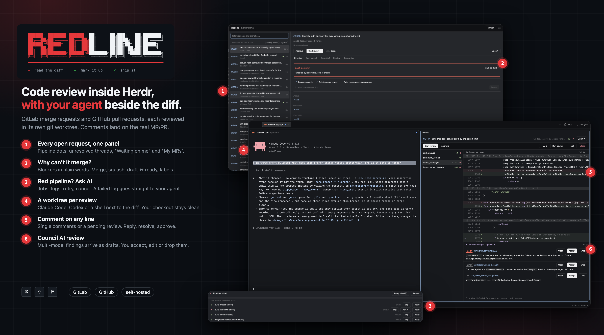

# Redline

Code review inside Herdr. `cmd-shift-f` opens a panel of the repo's open GitLab merge requests or GitHub pull requests. It shows whether each one can merge, its pipeline, its comment threads and its commits, and lets you merge, approve and reply. **Start review** checks the request out in its own git worktree and opens a tab with an AI agent on the left and a diff pane on the right. In the diff pane you comment on lines, collect a pending review, accept AI findings and submit.

## What you see

**The panel**: a dialog 88% × 86% of the window (`mod.json` overlay `kind: "dialog"`), on the theme's `popover` background.

- **Header bar, 44px**, `chrome` background:
  - "Redline" in 14px semibold, then the repo (`owner/name`, muted, 12px);
  - **Refresh** and "Esc" on the right.
- **Left column, 380px:**
  - a filter input, 34px, with an `accent` border;
  - a section label "OPEN MERGE REQUESTS · n" (or PULL), with two pill filters on the right: **Waiting on me** and **My MRs**;
  - request rows, 46px each:
    - `!123` or `#123` in `accent`;
    - the title, and below it in `dim` the author, "draft" and "fork". In **My MRs** that subtitle line shows what blocks the merge, or "Ready to merge";
    - an 8px pipeline dot: `ansi2` passed, `ansi1` failed, `working` running, `dim` pending;
    - `◆n` unresolved threads in `blocked`;
    - a "you" badge (`accent` at 30% alpha) when you're a requested reviewer and haven't approved;
    - the age (5m, 3h, 2d).
  - Then "BRANCHES": recent local and origin branches with no request, showing "→ main".
- **Right side:**
  - The title row: `!123` and the 15px semibold title. Below it the author, `source → target` and draft, then "Approved by …".
  - Buttons:
    - **Approve** ("✓ Approved" once you have);
    - **Start review ▸**, the primary button;
    - the agent dropdown "with Claude Code ▾";
    - **Open ↗**.
  - The tabs:
    - **Overview**:
      - a status card with a 1px border: `ansi2` "Ready to merge", or `blocked` "Can't merge yet" with bullet blockers. Also "6 commits behind main" and a **Mark as draft / ready** button;
      - a merge card with three checkboxes (Squash commits, Delete source branch, Merge when the pipeline succeeds) and **Merge**;
      - then LABELS, ASSIGNEES and REVIEWERS as removable pills with "+ add".
    - **Comments n**: threads as cards. Inline ones have a `raised` header "path:line · resolved/unresolved". Notes are rendered markdown. Each thread has **Reply** and **Resolve**, and a comment box sits at the bottom.
    - **Commits n**: short sha in `accent`, title, author · age.
    - **Pipeline**: the label carries ✓/✗/●. "✗ Pipeline failed #id" with **Retry failed (n)**, **Refresh** and **Open ↗**. Then, per stage, an uppercase `dim` heading and 30px job rows:
      - icon ✓ ✗ ● ○ ⊘ » ▶;
      - name, and duration on the right;
      - **Log**, **Ask AI** (failed jobs only), **Retry/Run** and **Cancel**.
      GitLab child pipelines appear as "bridge › stage" groups.
    - **Description**: markdown.
  - With no repo, nothing loaded or nothing selected, the right side shows the block logo instead. "REDLINE" is drawn in box characters, RED in `#E5383B` and LINE in `foreground`, with a `#E5383B` bar under it and the tagline "− read the diff  + mark it up  ✓ ship it".

**The review tab**, named "Review !123": a terminal (the chosen agent) and, split to its right, the Redline pane.

- **Header, 40px:** `!123` and the title, `branch → target`, `+add` in `ansi2`, `−del` in `ansi1`, and **Open ↗**.
- **Review bar, 40px**, `chrome` background:
  - **Start review** and **Approve**, or while reviewing a "Reviewing · n pending" badge, **Submit review ▾** and **Discard**;
  - a pipeline chip "✓ Pipeline success";
  - "✦ AI n" and **Run council**;
  - **Update**, shown only when the worktree is behind the request;
  - **Finish**, and **Close** with an `ansi1` border.
- **Files column, 240px:** file names with `●n` pending comments, `◆n` threads, and +/−.
- **Diff:**
  - a 28px file header with a **Full file** toggle;
  - 20px monospace rows:
    - an 18px marker column: `●` pending in `accent`, `◆` thread in `muted`, `✦` AI finding in `ansi5`;
    - the old and new line numbers;
    - +/− on an `ansi2`/`ansi1` background at 9% alpha;
    - the code, syntax-coloured: keywords `ansi5`, strings `ansi2`, numbers `ansi3`, comments `dim`.
  - Hunk headers sit on `raised`.
- **Under the diff:** the "✦ Council findings · n open of m" panel. Each finding has a severity pill, `path:line` in `accent`, **Open**, **Accept** and **Drop**, and markdown text. Below that, the composer. With nothing selected it reads "Click a line (shift-click for a range)…". With a selection it shows:
  - the location;
  - the threads already on that line (with **Reply** and **Resolve**) and your pending comments (with **Edit** and ✕);
  - a textarea with an `accent` border;
  - **Ask AI**, then **Add single comment** and **Start a review / Add review comment**. In reply or edit mode these become **Reply** or **Save pending comment**.

## How it behaves

- `cmd-shift-f` / `ctrl-shift-f` (`mod.open:redline`) toggles the panel. The repo is the one the focused terminal is in, and its machine is that space's machine.
- **Keys in the panel:**
  - ↑/↓ moves through requests;
  - Enter or a double-click starts a review;
  - Tab cycles the agent choice;
  - Esc leaves a text box first, then closes.
- **Agent dropdown:** installed agents (from `knownAgents`), then **Council review** (only if Claude Code is installed), then **Shell only**. The choice is remembered in shared `redline.agent`.
- **Start review:**
  1. Fetches the target and the source branch. A fork is fetched into `refs/review/mr-N`.
  2. Reuses a worktree under `~/.herdr/worktrees/<repo>/` that already has the branch. Otherwise it creates `~/.herdr/worktrees/<repo>/<branch>`. If the branch is checked out elsewhere (your main checkout), the new worktree gets a branch `review/<branch>` from the same commit.
  3. Opens a tab (`space.new`, or `tab.new` in the worktree's existing space) with the agent. Council review sends the `/council` brief as its first message.
  4. Waits up to 5s for the terminal, then runs `pane.split` right with the Redline pane.
  A fetch that fails (auth, SSO) is reported as a warning toast and never passes silently.
- **Selecting lines:**
  - A click selects a line; shift-click extends to a range. A range can't cross a hunk header.
  - **Ask AI** `hc send`s the lines, as a diff, plus your text to the agent in this tab. It only sends to an agent (`agents()`), never to a plain shell.
  - **Add single comment** posts a positioned comment now.
  - **Start a review / Add review comment** creates a pending comment: a GitLab draft note on the server, or kept locally for GitHub.
- **Submit review** offers Comment, Approve and (GitHub) Request changes, with a summary. It is refused, with the reason shown, when there's nothing to submit, when Request changes has no summary, or when a GitHub pending comment was written on an older head.
- **Comments are only allowed** when the worktree's HEAD equals the request's head. Otherwise **Update** appears: it fetches and fast-forwards, and explains when the request was rebased or force-pushed.
- **Polling:**
  - The pane runs `git rev-parse` and `git status` every 5s and redraws only when something changed. Uncommitted edits only update a counter; they don't reload the diff or clear the selection.
  - It checks the request every 60s for new pushes and pipeline state.
  - A running pipeline in the panel refreshes every 15s.
- **Council findings:** the brief tells the agent to write findings to `<git-dir>/redline-findings.json` as `[{path, line, side, severity, body}]`. The pane reads that file on its 5s tick.
  - **Accept** adds a finding as a pending comment.
  - **Open** jumps to its line with the text in the box.
  - **Drop** dismisses it.
  State is kept in shared `redline.findings.<folder>`.
- **Finish** asks first. It asks again if the worktree has uncommitted or unpushed work, then removes the worktree (only paths under `.herdr/worktrees/`), deletes a `review/*` branch, and closes the tab.
- **Merge** needs a confirm click. **Mark as draft** renames the GitLab title with a `Draft:` prefix; on GitHub it runs `gh pr ready --undo`.
- **Pipeline Log** opens a new tab running `glab api …/jobs/<id>/trace | less -R` or `gh run view --job <id> --log | less -R`, and closes the panel.
- **Pipeline Ask AI** sends the last 150 log lines, with timestamps and ANSI codes removed, to the agent in the "Review !N" tab. If there's no such tab, it starts the review with that as the first message.

## Built from

- **Mod:** `mods/redline/`, `mod.json` `{ "place": "none", "focusable": true, "overlay": { "kind": "dialog", "width": 0.88, "height": 0.86 } }`. `main.js` picks a role from its props:
  - `props.redline` → the review pane (`diff.js`);
  - `props.watch` → the watcher (`watch.js`, disabled; see Watch out);
  - otherwise → the panel (`launcher.js`).
- **Files:**
  - `panels.js`: Overview and Pipeline tabs.
  - `hosting.js`: every GitLab/GitHub call.
  - `lib.js`: git, checkout, diff/numstat parsing.
  - `highlight.js`: a line tokenizer.
  - `logo.js`: the block logo. `logo.ans` is the same logo for a terminal (`cat` it).
- **Pane props:** `{ provider, host, repo, on, folder, branch, target, number, title, url, tab, upstream: { fetch, ref }, findings }`.
- **`herdr` functions:**
  - `exec` (git, glab, gh, sh, open, sleep), `hc(["send", …])`;
  - `focused`, `spaces`, `panes`, `agents`, `knownAgents`;
  - `readTextFile`, `shared` / `setShared`, `notify`;
  - `run`, `props`, `closeOverlay`, `openOverlay`, `home`, `nextCommand`.
- **Commands:** `space.new`, `tab.new`, `pane.split`, `tab.close`, `mod.open`.
- **UI controls from gpui-base:** `InputState`/`Input`, `TextareaState`/`Textarea`, `TextView.markdown`, `Popover`, `v_virtual_list` with `on_item_click`, `Scrollbar`.
- **Programs:**
  - `git`;
  - `glab api` (REST and GraphQL, `--paginate --output ndjson`, `--input -` for JSON bodies);
  - `gh` (`pr list/view/checks/merge/ready/edit/review/comment/close`, `run rerun/cancel/view`, `api` with `--paginate --slurp`, GraphQL).
- **GitLab:** discussions, draft_notes plus `bulk_publish`, approve/unapprove, merge, `cancel_merge_when_pipeline_succeeds`, pipelines, jobs and bridges (child pipelines), job trace, `users?username=`. GraphQL `mergeRequests { headPipeline, reviewers, approvedBy, resolvable/resolvedDiscussionsCount, detailedMergeStatus }`.
- **GitHub:** `pulls/N/comments` (with `line`/`side`/`start_line`), `pulls/N/reviews` (one review with all comments), comment replies, GraphQL `pullRequests { reviewRequests, latestReviews, reviewThreads, statusCheckRollup, mergeStateStatus }`.
- **Keys:** `keys.json` (merged into the person's `"global"` section).

## Watch out

- **Inside a `v_virtual_list`, an `on_click` on a row throws**, and the list draws nothing. Use the list's `on_item_click(key)`. Track shift with `on_modifiers_changed` on the root.
- **A `cx` kept across an `await` is stale.** Callbacks that run after a network write must take the spawned task's `cx`. Otherwise a successful write reports "failed", and people retry and duplicate.
- **`h_flex` centres children vertically.** A column inside it needs `h_full()` or it collapses.
- **Diff parsing:** file headers (`---`, `+++`, `index`) only appear before a file's first `@@`. Inside a hunk, a removed line `-- comment` reads as `--- comment`. Skipping it shifts every following line number.
- **`glab api --paginate` (1.127) prints one JSON array per page**, back to back, despite its help text. Use `--output ndjson`. `gh` needs `--slurp`, then flatten.
- **`git fetch` into a branch a worktree has checked out is refused.** Fetch forks into `refs/review/…`.
- **GitLab job traces** start each line with a timestamp and a stream marker glued to the text: `…Z 00O+text`. Section markers end with `[collapsed=true]`.
- **A kept overlay window**, even 1×1 with `frame: "none"`, **blocks clicks in Herdr**. Background notifications need a layout block (a floating block or a docked status mod), not a window. The watcher is written but switched off.
- **When splitting a pane in a space you just opened, always pass `pane`.** Focus may still be elsewhere.
- **GitLab range comments need `line_range` with `line_code`s.** Redline posts on the range's last line and says so. GitHub gets `start_line`.
- **Comments only land** on lines GitLab or GitHub show: 3 lines of context around a change. GitHub rejects lines further out. The full-file view dims those lines and blocks commenting on them.
- **`glab api --input -` sends no Content-Type before glab 1.123.0** (1.123.0 defaults to `application/json`), and GitLab answers HTTP 415 to every JSON write. Older glab versions are still common, for example from distribution packages. Pass `-H "Content-Type: application/json"`. glab prints the API's error body on stdout and only "HTTP 415" on stderr: report both.
- **GitLab works out mergeability in the background.** After a push, or a merge into the target, every open request reads `checking` or `unchecked` for a few seconds. Poll again instead of showing it as a blocker until Refresh.
- **Write paths are proven on GitLab only.** On GitHub, merge, draft, labels/assignees/reviewers, retry/cancel, submit and close follow the documented APIs but haven't all been run against a real pull request.
- **Menlo is macOS only.** Draw the block logo in JetBrains Mono, which Herdr ships everywhere.
- **The request list shows 50.** The list query fetches the first 50.

## Done when

- `herdr-app check mods/redline` passes, and the panel opens with `cmd-shift-f` in a repo with an `origin` on GitLab or GitHub.
- The list shows the open requests with pipeline dots, and "you" on the ones whose review you were asked for. **My MRs** shows your own with their blockers.
- Overview shows "Ready to merge" or the blockers. The Pipeline tab lists stages and jobs, including GitLab child pipelines, and **Log** opens a tab with the job's log.
- **Start review** creates `~/.herdr/worktrees/<repo>/<branch>` (or `review-<branch>`) and opens a tab with the agent and the diff pane, without touching the main checkout.
- In the diff, a removed `-- comment` line is shown and the line numbers after it are right. Go and SQL lines are coloured.
- Selecting a line and **Ask AI** puts the lines and the question in the agent's input. With **Shell only** it refuses.
- A findings file in the git dir shows ✦ markers and the findings panel. **Accept** creates a pending comment.
- **Finish** removes the worktree and closes the tab.
